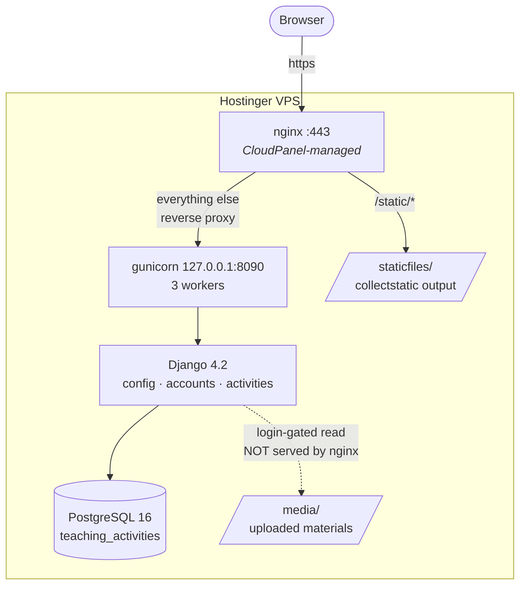
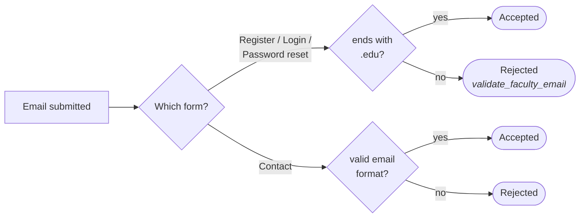
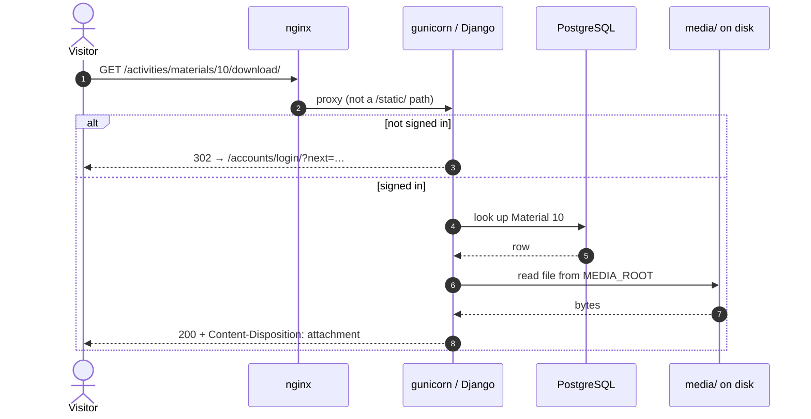

# Architecture

How TeachOrange fits together, and why it is arranged this way.

## At a glance



`/static/` is served straight off disk by nginx. **`/media/` is not** — uploads are
read by Django so the `@login_required` gate applies. See
[Why media is served by Django](#why-media-is-served-by-django).


Operational detail — how gunicorn is started, reloaded and deployed — lives in
[operations.md](operations.md).

## Django apps

| App | Responsibility |
|---|---|
| `config` | Settings, root URLconf, WSGI/ASGI, protected media, error helpers |
| `accounts` | Registration, login, password reset. **No models** — uses `auth.User` |
| `activities` | Catalogue: `Category`, `Tag`, `Activity`, `ActivityTag`, `Material` |

`accounts` has no `migrations/` directory because it defines no models. Users are
plain `django.contrib.auth.models.User`, with the **email address stored as the
username**. That is why sign-up validation lives in a form rather than a model.

## Access model

This is the part most worth understanding, because it is easy to get wrong.

| Area | Anonymous | Signed in |
|---|---|---|
| Home, Team, Consulting, Contact | ✅ | ✅ |
| Browse activities, activity detail | ✅ | ✅ |
| `/tags/`, `/categories/` (JSON) | ✅ | ✅ |
| **Preview / download a material** | ❌ 302 → login | ✅ |
| `/media/<path>` | ❌ 302 → login | ✅ |
| `/admin/` | ❌ | staff only |

**Browsing the catalogue is public. Only the files are gated.** Someone can read
every activity description and tag without an account; they need a `.edu` address
only to open or download the attached materials.

Enforcement lives in exactly two places:

- `activities/views.py` — `@login_required` on `material_open` and `material_download`
- `config/media_serve.py` — `@login_required` on `protected_media`

### Why media is served by Django

`config/urls.py` routes `media/<path:path>` to `protected_media`, a `@login_required`
wrapper around `django.views.static.serve`. This is deliberate and slightly unusual:
serving uploads through Django is slower than letting nginx do it, but an nginx
`alias` for `/media/` would hand every uploaded file to anonymous users and silently
bypass the gate above.

> **If you ever edit the nginx vhost, do not add a `location /media/` block.**

## Sign-up rules

Registration and login both require a university address. The rule is one function,
`validate_faculty_email()` in `accounts/forms.py`, driven by a single setting:

```python
ALLOWED_EMAIL_SUFFIXES = (".edu",)   # config/settings.py
```

It is enforced in three places that must stay in agreement:

1. `SignUpForm.clean_username` — registration
2. `TeachOrangeAuthenticationForm.clean_username` — login
3. `EduPasswordResetForm.clean_email` — password reset

Plus two client-side mirrors, which exist only to give faster feedback and are
never the authority: `templates/accounts/register.html` and
`templates/registration/login.html`.

**The contact form is deliberately different.** `ContactForm.email` is a plain
`EmailField` with no suffix rule — anyone may contact the team. Do not "fix" this
by copying the `.edu` check across; it would reject legitimate senders.



Client-side JavaScript mirrors both branches for faster feedback, but is never the
authority — the server validates every submission regardless.

## Request flow for a material download

Worth tracing once, because it crosses every layer and shows where the gate sits.



`material_open` follows the same path but renders inline for previewable types,
using `Material.preview_pdf` when the main file is not itself a PDF.

## Error handling

Project-wide 404 and 500 render **HTML**, using `templates/404.html`. There is no
`handler404` override.

`config/error_handlers.py` provides `json_error_response()`, but its own docstring
notes it is *"not used as project-wide 404/500"* — only views that opt in return
JSON. A bad activity slug therefore returns an HTML 404, not a JSON body. A test
asserting otherwise was wrong, and was fixed rather than the behaviour.

## Static files

| | |
|---|---|
| `STATIC_URL` | `static/` |
| `STATICFILES_DIRS` | `BASE_DIR/static` (source) |
| `STATIC_ROOT` | `BASE_DIR/staticfiles` (build output, gitignored) |
| Storage | `whitenoise.storage.CompressedStaticFilesStorage` |

WhiteNoise is in `MIDDLEWARE`, but in production **nginx serves `/static/` from disk
first**, so WhiteNoise is effectively a fallback. `staticfiles/` is gitignored and
must be regenerated by `collectstatic` on every deploy — forgetting this is why
`favicon.svg` 404'd after an early deploy.

## Data model

See [er_diagram.md](er_diagram.md) for the full diagram and `schema.sql` for DDL.

```
Category 1───* Activity *───* Tag          (through ActivityTag)
                  │
                  1
                  │
                  *
               Material
```

- `Activity.slug` is unique and auto-populated; it is the public URL key
- `Material.file` is the download; `Material.preview_pdf` is an optional PDF
  rendering used when `file` is not a PDF
- `ActivityTag` is an explicit through-model, so tag assignments carry `created_at`

## Conventions worth knowing

- **Templates own their CSS.** Each page puts its styles in ``
  rather than a shared stylesheet. Shared design tokens are CSS custom properties
  on `:root` in `templates/base.html` (`--su-navy`, `--su-orange`, …).
- **Cover images are hotlinked from Unsplash**, chosen deterministically by
  `activity.id % 12` in `activities/tile_images.py`, so a given activity always
  shows the same photo.
- **Client-side validation never gates anything.** The server validates every
  submission; JS only moves the feedback earlier.
