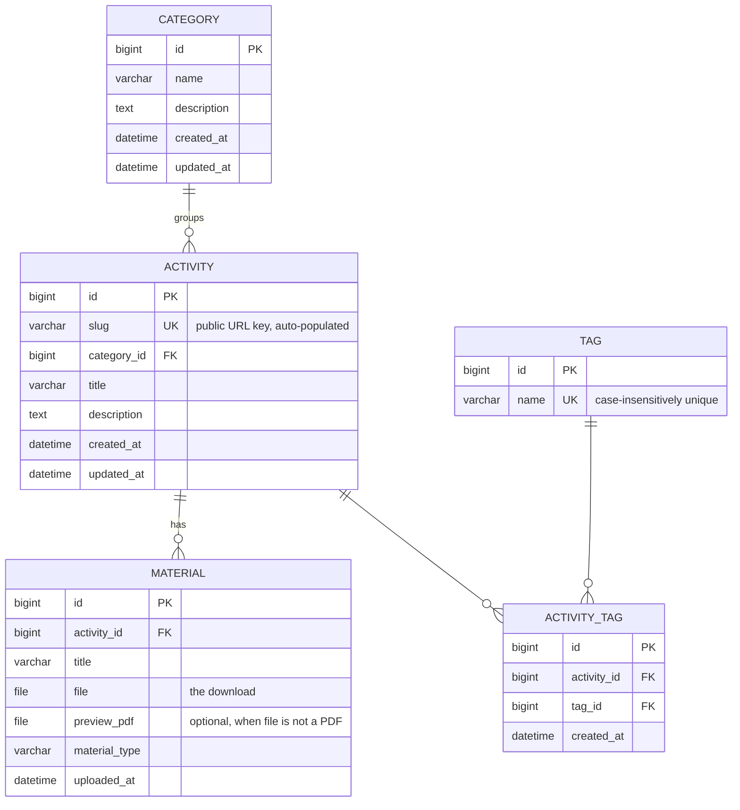

# Entity-Relationship Diagram

## Teaching Activities Platform : Database Schema



`ACTIVITY_TAG` is an explicit through-model rather than a plain `ManyToManyField`,
so each tag assignment carries its own `created_at`.

`material_type` is one of `worksheet`, `instructions`, `example`, `video`.


## Relationships Summary

| From       | To         | Cardinality | Description                          |
|------------|------------|-------------|--------------------------------------|
| Category   | Activity   | 1 : N       | One category groups many activities   |
| Activity   | Material   | 1 : N       | One activity has many materials       |
| Activity   | Tag        | N : N       | Activities and tags are many-to-many via ActivityTag |
| ActivityTag| Activity   | N : 1       | Many activity-tag pairs per activity  |
| ActivityTag| Tag        | N : 1       | Many activity-tag pairs per tag       |

## Migration notes

| Migration | Effect |
|---|---|
| `0004_add_activity_slug` | Added `Activity.slug` (unique). Mixes raw SQL with a `RunPython` whose reverse is a no-op — **not safely reversible** |
| `0005_material_preview_pdf` | Added `Material.preview_pdf` |
| `0006_add_curriculum_categories` | Seeds 10 `Category` rows as **data**, no schema change. Tests must not assume the table starts empty |

Regenerate the authoritative field list at any time:

```bash
python manage.py inspectdb                      # from the live database
python manage.py sqlmigrate activities 0001     # DDL for a given migration
```
