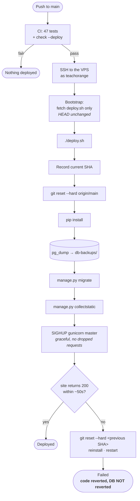
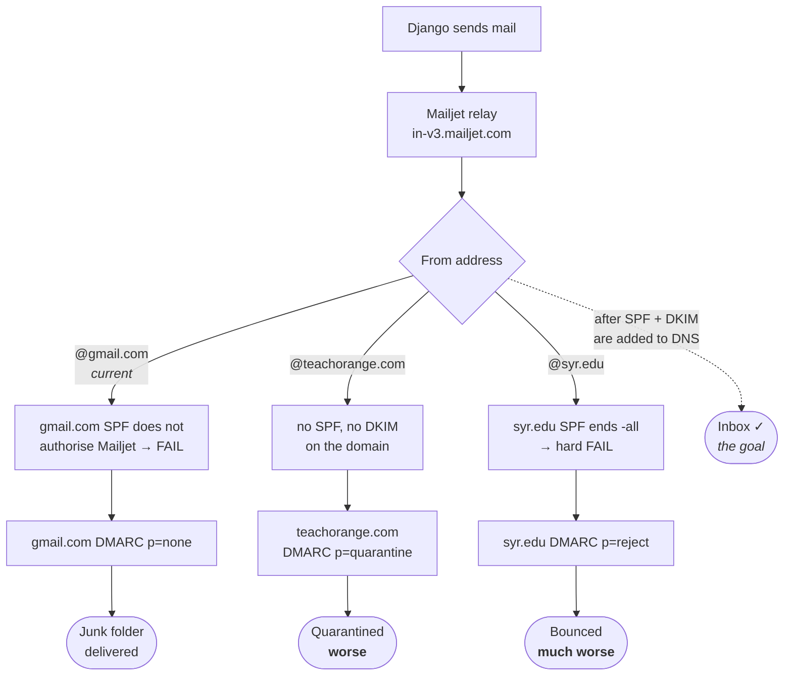

# Operations

Running TeachOrange in production: how it deploys, where things live, and what to
do when something breaks.

## The production host

| | |
|---|---|
| Provider | Hostinger VPS, `72.60.174.100` |
| Control panel | CloudPanel 2.5.4 (`https://72.60.174.100:8443`) |
| Site user | `teachorange` |
| App directory | `/home/teachorange/htdocs/www.teachorange.com` |
| Virtualenv | `venv/` — **not** `.venv/` |
| Python | 3.12 |
| Web server | nginx (CloudPanel-managed) → gunicorn on `127.0.0.1:8090` |
| Database | PostgreSQL 16, `teaching_activities`, user `teachorange_app` |
| Logs | `/home/teachorange/logs/gunicorn-{access,error}.log` |
| Config | `.env` in the app directory, owned by the site user, never committed |

### How gunicorn runs

**There is no systemd unit and no supervisor program.** gunicorn runs as a bare
process owned by `teachorange`, with `PPID 1`:

```
venv/bin/gunicorn config.wsgi:application --bind 127.0.0.1:8090 \
  --workers 3 --timeout 120 \
  --access-logfile /home/teachorange/logs/gunicorn-access.log \
  --error-logfile  /home/teachorange/logs/gunicorn-error.log
```

The site user's only `sudo` right is `/usr/bin/clpctlWrapper`, so services cannot be
managed with `systemctl`. Reloading is therefore done by **signal**:

```bash
kill -HUP <gunicorn-master-pid>     # graceful: workers restart on the new code
```

`SIGHUP` works here because gunicorn is not running with `--preload`. Workers are
replaced one at a time, so no request is dropped and the master PID does not change.

> ⚠️ **Nothing supervises the master.** If it dies, the site stays down until a human
> notices. `deploy.sh` starts one if it finds none, but that only helps during a
> deploy. **Putting gunicorn under a real process manager is the most valuable
> outstanding improvement to this setup.**

### nginx

The vhost is generated by CloudPanel (Sites → `www.teachorange.com` → Vhost). Hand
edits to `/etc/nginx/sites-enabled/` get overwritten — change it through the panel.

> **Never add a `location /media/` block.** Uploads are gated by `@login_required`
> in `config/media_serve.py`; an nginx alias would serve every uploaded file to
> anonymous users. See [architecture.md](architecture.md#why-media-is-served-by-django).

## Deploying

**Pushing to `main` deploys automatically.** `.github/workflows/deploy.yml` waits for
the test suite, then runs `deploy.sh` on the server over SSH.

### The pipeline



> The database is **not** rolled back. That is why `pg_dump` runs before `migrate`:
> restoring schema means restoring a dump, by hand.

### What `deploy.sh` does

1. Records the current commit for rollback
2. `git fetch` + `git reset --hard origin/main`
3. `pip install -r requirements.txt`
4. **`pg_dump` to `../db-backups/`** (gzipped, last 10 kept)
5. `manage.py migrate --noinput`
6. `manage.py collectstatic --noinput` — `staticfiles/` is gitignored and must be
   rebuilt every time
7. `SIGHUP` the gunicorn master (starts one if absent)
8. Polls the site for `200`; on failure restores the previous commit and exits non-zero

`git reset --hard` does not touch untracked files, so `.env`, `media/` and `venv/`
survive a deploy.

### The bootstrap step

The workflow fetches `deploy.sh` itself before running it:

```bash
git fetch --all --prune
git checkout origin/main -- deploy.sh
```

This exists because the first deploy failed with `./deploy.sh: No such file or
directory` — the checkout predated the script, and the script is what pulls new
code. `git checkout <ref> -- <path>` does not move `HEAD`, so the rollback target
stays correct. It also means a change to `deploy.sh` takes effect in the same run
that introduces it.

### GitHub secrets

Settings → Secrets and variables → Actions:

| Secret | Value |
|---|---|
| `DEPLOY_HOST` | `72.60.174.100` |
| `DEPLOY_USER` | `teachorange` |
| `DEPLOY_PATH` | `/home/teachorange/htdocs/www.teachorange.com` |
| `DEPLOY_SSH_KEY` | private key; public half in CloudPanel → Settings → SSH Keys |
| `DEPLOY_PORT` | optional, defaults to `22` |

### Deploying by hand

```bash
ssh teachorange@72.60.174.100
cd /home/teachorange/htdocs/www.teachorange.com
./deploy.sh
```

Or re-run the current `main` from the Actions tab via **Run workflow**
(`workflow_dispatch`).

## Rolling back

`deploy.sh` reverts the **code** automatically if the health check fails. Manually:

```bash
cd /home/teachorange/htdocs/www.teachorange.com
git reset --hard <previous-sha>
./deploy.sh
```

> **Migrations are never rolled back.** `0004_add_activity_slug` mixes raw SQL inside
> `SeparateDatabaseAndState` with a `RunPython` whose reverse is a no-op, so reversing
> it leaves data behind and can desynchronise Django's migration state from the real
> schema. If a deploy applied a migration, restoring schema means restoring a dump:

```bash
gunzip -c ../db-backups/teachorange-YYYYMMDD-HHMMSS.sql.gz | psql teaching_activities
```

## Backups

`deploy.sh` dumps the database before every migration, keeping the last 10 in
`/home/teachorange/db-backups/`.

> ⚠️ **Uploaded files are not backed up.** `media/` holds the activity materials,
> is gitignored, and exists only on this server. `pg_dump` captures rows, not files.
> If the VPS were lost, the records could be restored and **the materials could not.**
> A periodic `media/` backup is an outstanding gap.

## Email

Configured through Mailjet, and it authenticates successfully — but **deliverability
is currently unreliable**, and failures are invisible.

| | |
|---|---|
| Backend | `smtp.EmailBackend` |
| Host | `in-v3.mailjet.com:587`, TLS |
| From | `TeachOrange <kgabhijnya17@gmail.com>` |
| Contact goes to | `mdbrockw@syr.edu` |

### The problem

Mail is relayed through **Mailjet** but claims to come from **gmail.com**. Google's
SPF (`v=spf1 redirect=_spf.google.com`) does not authorise Mailjet, so **SPF fails on
every message** and DKIM does not align. gmail.com publishes `p=none`, so nothing is
rejected outright — messages are simply filtered. Django reports success either way,
so a reset email that never arrives produces no error anywhere.

### Status: blocked on DNS access — do not change the From address yet

Confirmed by live test on 2026-10-24: a password-reset email **was delivered, into
the junk folder**, and the reset link worked. So the application is fine; only the
sender identity is wrong.

Every alternative is currently **worse** than the status quo:




| From address | SPF result | Domain DMARC | Outcome |
|---|---|---|---|
| `@gmail.com` *(current)* | fail | `p=none` | **Junk folder** — delivered |
| `@teachorange.com` | no record | `p=quarantine` | **Quarantined** |
| `@syr.edu` | `-all` hard fail | **`p=reject`** | **Rejected outright** |

`teachorange.com` publishes `p=quarantine` with no SPF and no DKIM, so switching the
From address *before* the DNS records exist moves mail from junk to quarantine.
`syr.edu` publishes `p=reject`, so sending as a Syracuse address through Mailjet is
bounced. **Leave `DJANGO_DEFAULT_FROM_EMAIL` alone until DNS is in place.**

### What is needed

`teachorange.com` has been added as a sender domain in a Mailjet account owned by
the project (`ntipturm@syr.edu`), but is **unvalidated**. Validation needs a DNS
record, and nobody on the team currently has the GoDaddy credentials — WHOIS is
privacy-protected (Domains By Proxy), so the holder is unconfirmed. The domain was
created 2026-05-11; Abhijnya set up the hosting and the original Mailjet account.

**Step 1 — domain verification.** Ask the GoDaddy holder to add:

| Type | Host | Value |
|---|---|---|
| `TXT` | `mailjet._d004d7a6` | `d004d7a6b63a8eaa62376f23f4f6a036` |

GoDaddy appends the domain, so the Host field takes `mailjet._d004d7a6`, not the
fully-qualified name.

**Step 2 — SPF and DKIM.** Mailjet issues these only after step 1 verifies. These
are the records that actually fix deliverability. Note `teachorange.com` has **no
SPF record today**, so this is an addition — and a domain must have exactly one SPF
record, or it is an automatic fail.

**Step 3 — switch the From address.** Only once steps 1 and 2 resolve:

```bash
# in the server .env
DJANGO_DEFAULT_FROM_EMAIL="TeachOrange <noreply@teachorange.com>"
```

Then reload gunicorn and re-run the test: register or use an existing account,
request a password reset, and confirm it lands in the inbox rather than junk.

Mailjet also offers OAuth auto-configuration for GoDaddy, which would do steps 1
and 2 automatically. That grants Mailjet permission to modify any record on the
domain, so it is the domain holder's decision.

Switching the From address is also worth doing for credibility, not only
deliverability: a university platform sending password-reset links from a student's
personal Gmail reads as phishing even when it reaches the inbox.

### Checking email health

```bash
cd /home/teachorange/htdocs/www.teachorange.com
venv/bin/python - <<'PY'
import os, django
os.environ.setdefault("DJANGO_SETTINGS_MODULE","config.settings"); django.setup()
from django.conf import settings
from config.email_status import email_delivery_available
from django.core.mail import get_connection
print("backend:", settings.EMAIL_BACKEND)
print("delivery available:", email_delivery_available())
c = get_connection(); c.open(); print("SMTP auth: OK"); c.close()
PY
```

If `DJANGO_EMAIL_HOST` or `DJANGO_EMAIL_HOST_USER` is unset, the backend silently
falls back to console and **the contact form and password reset return HTTP 503**
while the rest of the site looks healthy. A homepage health check will not catch it.

## Troubleshooting

| Symptom | Where to look |
|---|---|
| Site down, 502 from nginx | gunicorn master died — nothing restarts it. `pgrep -u teachorange -f gunicorn`, then re-run `deploy.sh` |
| Deploy failed at health check | Code was rolled back automatically; database was **not**. Check `gunicorn-error.log` |
| Styles or favicon 404 | `collectstatic` did not run |
| Contact form / reset → 503 | SMTP env vars missing; backend fell back to console |
| Emails send but never arrive | SPF/DKIM — see **Email** above |
| 500 on activity pages after a deploy | A migration did not apply; check `manage.py showmigrations` |
| Deploy workflow fails instantly, no jobs | Workflow YAML is invalid — a reusable workflow needs `on: workflow_call` |

Useful:

```bash
tail -f /home/teachorange/logs/gunicorn-error.log
cd /home/teachorange/htdocs/www.teachorange.com && venv/bin/python manage.py showmigrations
ss -ltnp | grep 8090
```

## Known gaps

Ordered roughly by risk:

1. **Nothing supervises gunicorn** — a crash means downtime until someone notices
2. **`media/` is not backed up** — uploaded materials are unrecoverable if the VPS is lost
3. **Email deliverability** — confirmed landing in junk. Blocked on GoDaddy DNS
   access; see **Email** above. Do not change the From address before the records exist
4. **CloudPanel's TLS certificate expired in 2020** (`CN=cloudpanel.clp`), so every
   admin login to the panel is over an unverifiable connection
5. **`CONTACT_EMAIL` defaults to a personal address** hardcoded in a public repo;
   set `DJANGO_CONTACT_EMAIL` in the server `.env` instead
6. **HSTS `includeSubDomains` / `preload`** are unset — `check --deploy` reports both.
   Preload is effectively irreversible for a domain, so decide deliberately
